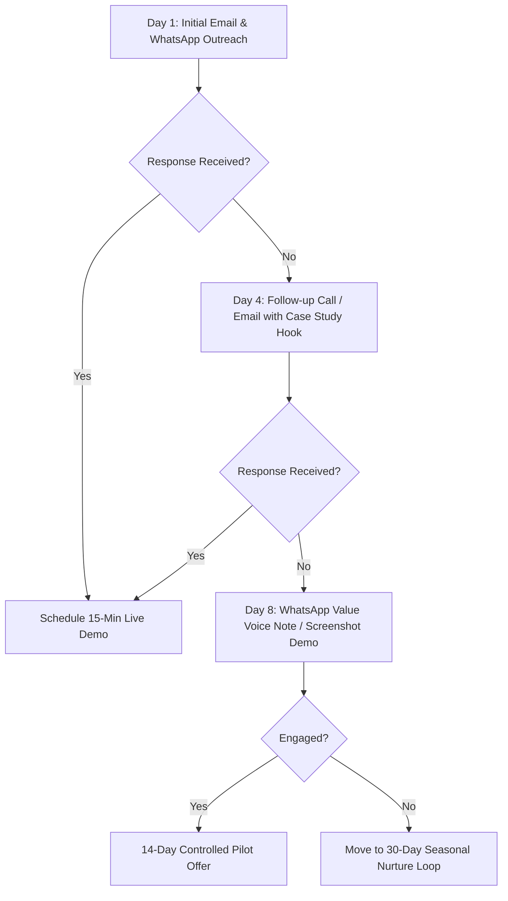

# AdmitFlow AI — B2B Sales Outreach & Commercial Strategy Playbook
**Document Version**: 1.0.0-P8-STEP5  
**Audience**: Internal Sales Team, Solutions Architects, and Founders  
**Objective**: Structured B2B acquisition framework for 50 Indian coaching institutes with zero synthetic pipeline inflation.

---

> [!IMPORTANT]
> **Operational Compliance Rules**:
> 1. No automated spamming: All outreach messages are manual, personalized templates.
> 2. No synthetic prospects: Every prospect entered into the CRM must be a verified coaching institute.
> 3. Zero-Revenue Rule: Proposed pricing (₹9,999/mo) is never recorded as realized MRR until confirmed bank/gateway capture.

---

## 1. Verified Prospect Qualification Framework (BANT-C Model)

Before adding any coaching institute into the AdmitFlow B2B Sales Pipeline, sales representatives must evaluate the prospect against the **BANT-C** framework:

| Dimension | Qualification Criteria for Coaching Institutes | Disqualification Red Flags |
|---|---|---|
| **Budget (B)** | Annual admission fee turnover ≥ ₹50 Lakhs. Can allocate ₹5,000–₹15,000/month for admission automation & software. | Single-tutor home tuition centers with total student count < 20. |
| **Authority (A)** | Outreach directed strictly to Director, Managing Trustee, Center Head, or Chief Marketing Officer (CMO). | Reaching out to junior receptionist or student helpline number. |
| **Need (N)** | Drops parent inquiries outside 9 AM – 7 PM; slow counselor response time (> 30 mins); manual paper or spreadsheet lead management. | Institute already has a fully automated in-house conversational AI and unified CRM. |
| **Timeline (T)** | Approaching upcoming batch intake cycle (Foundation batches in March–April or Dropper batches in July–August). | No upcoming batches within the next 6 months. |
| **Compliance (C)** | Willingness to comply with India DPDP Act 2023 (collecting opt-in consent for student communications). | Unwillingness to adhere to statutory opt-in requirements. |

---

## 2. Defined Target Institute Categories & Positioning

### Category 1: IIT-JEE & NEET Coaching Institutes (Primary Focus - Track A & B)
- **Scale**: 200–5,000 students across 1 to 5 regional branches (e.g., Kota, Sikar, Jaipur, Hyderabad, Patna, Lucknow).
- **Core Pain Point**: Parents research courses and fee structures late at night (8 PM to 12 AM). Inquiries submitted on traditional contact forms are lost to competitors if not engaged within 15 minutes.
- **Value Hook**: 24/7 bilingual (English & Hinglish) admission assistant grounded strictly in official prospectus documents. Zero hallucination on batch fees or scholarship slabs.

### Category 2: Coding & Full-Stack Tech Academies
- **Scale**: 100–1,000 learners per cohort (Bengaluru, Pune, Delhi NCR, Hyderabad, Online).
- **Core Pain Point**: High drop-off between brochure download and 1-on-1 counseling scheduling. Tech-savvy students expect instant, intelligent conversational responses.
- **Value Hook**: Automated developer-friendly admissions, conflict-free counseling slot booking with Google Calendar integration.

### Category 3: Civil Services & UPSC Academies
- **Scale**: 300–2,000 aspirants (Delhi Mukherjee Nagar/Old Rajinder Nagar, Prayagraj, Jaipur, Bhopal).
- **Core Pain Point**: Highly detailed optional subject syllabus queries, hostel tie-up questions, and heavy counselor workload.
- **Value Hook**: Instant grounding in syllabus, test series schedules, and optional subject fee breakdowns.

### Category 4: Commerce & Chartered Accountancy (CA) Institutes
- **Scale**: 150–800 students (Mumbai, Ahmedabad, Indore, Chennai, Kolkata).
- **Core Pain Point**: Complex foundation vs. intermediate installment structures, exemption queries.
- **Value Hook**: Precise multi-installment payment calculator and automated reminder queues.

### Category 5: K-12 Foundation & Board Tuition Centers
- **Scale**: 200–1,500 students (Tier-1 and Tier-2 suburban hubs).
- **Core Pain Point**: High volume of parent inquiries during school exam transition months (January to April).
- **Value Hook**: Simplified school syllabus Q&A and counselor lead qualification.

---

## 3. Core AdmitFlow AI Sales Pitch (Elevator Pitch)

> *"Namaste Sir/Ma'am. Coaching institutes spend lakhs on Google and Facebook ads to get parent inquiries, but more than 40% of parents research institutes between 8 PM and 11 PM when your counseling desk is closed.*  
> 
> *AdmitFlow AI is an AI Admission Assistant built specifically for coaching institutes. It lives on your website and WhatsApp, answers student questions about your courses, fees, and batch schedules in natural English and Hinglish with 100% accuracy from your official prospectus, and books confirmed campus counseling appointments directly onto your counselors' calendars.*  
> 
> *No wrong fee quotes, no missed inquiries, and zero double-bookings."*

---

## 4. Cold Email Outreach Templates (Personalized & Manual)

### Template 1: Director Initial Outreach (Inquiry Drop-off Angle)
```text
Subject: Late night inquiry drop-offs at [Institute Name] — quick question

Respected [Director Name],

I noticed that [Institute Name] is currently enrolling students for upcoming [Course Name/Batch Name] sessions in [City]. 

Like most top institutes in [City], your counseling team works hard during office hours. However, analytics from Indian coaching institutes show that nearly 42% of parents and students visit your website between 8 PM and midnight when your front desk is closed. By morning, many have already submitted inquiries to competing institutes.

AdmitFlow AI provides a specialized admission assistant that lives on your website:
1. Answers parent questions in fluent English and Hinglish using ONLY your official prospectus (zero hallucinated fees).
2. Captures verified student leads with India DPDP consent.
3. Automatically books campus counseling appointments onto your counselors' calendars without double-booking.

We have built and tested a specialized multi-branch admission sandbox tailored for Indian coaching institutes.

Could we schedule a brief 10-minute demonstration this Thursday or Friday to show you how it works on your actual prospectus?

Warm regards,

[Your Name]
AdmitFlow AI Admission Solutions
Phone: [Your Phone] | Website: https://admitflow.ai
```

### Template 2: Counselor Productivity & Efficiency Hook
```text
Subject: Reducing repetitive fee inquiries for [Institute Name] counseling staff

Respected [Director/Center Head Name],

Your admission counselors likely spend 60% of their daily call time repeating the exact same basic details: hostel tie-ups, installment dates, batch start schedules, and scholarship criteria.

AdmitFlow AI handles 100% of these preliminary repetitive queries automatically with conversational RAG intelligence, allowing your human counselors to focus only on high-intent students ready for fee payment and enrollment.

Key highlights:
- 2-second response latency in simple Hinglish and English.
- Automatic routing of Kota vs. [Branch] inquiries to the right counselor.
- Complete DPDP Act 2023 compliance with student opt-in audit trails.

I would love to share a 2-minute video preview customized with [Institute Name]'s course structure. Would that be of interest?

Best regards,

[Your Name]
AdmitFlow AI
```

### Template 3: Controlled 14-Day Pilot Invitation
```text
Subject: 14-Day Admission Automation Pilot for [Institute Name]

Respected [Director Name],

Rather than asking you to purchase software upfront, we would like to invite [Institute Name] to participate in an authorized 14-day zero-risk admission pilot.

Under this pilot:
1. We index your official 2026 prospectus into an isolated AI Knowledge Brain.
2. We provide an embeddable website widget tailored with your institute branding.
3. Your team receives full counselor accounts with appointment scheduling.
4. We evaluate real student engagement and inquiry conversion together.

You only consider a commercial subscription if your inquiry conversion measurably increases during the pilot.

Are you available for a 10-minute introductory call this week?

Warm regards,

[Your Name]
Founder / Solutions Lead, AdmitFlow AI
```

---

## 5. WhatsApp Outreach Templates (1-on-1 Manual Outreach)

> [!CAUTION]
> These templates must only be dispatched to official public business numbers or authorized institute decision-makers with prior conversational context. Never broadcast unsolicited mass messages.

### WhatsApp Template A: Direct Value Hook (Hinglish)
```text
Namaste [Director Sir / Ma'am], 

Maine [Institute Name] ki website check ki. Aapka [Course Name] program kafi popular hai [City] me. 

Ek quick observation: Shaam 8 baje ke baad aane wali parent inquiries ko respond karne me usually delay ho jata hai, jisse parent doosre institutes me contact kar lete hain.

Humne AdmitFlow AI banaya hai jo aapke official prospectus se 100% accurate Hinglish me student queries answer karta hai aur confirmed counseling slots book karta hai. 

Kya hum kal 10-minute ka quick live demo schedule kar sakte hain? 

- [Your Name], AdmitFlow AI (+91-XXXXXXXXXX)
```

### WhatsApp Template B: Post-Demo Follow-Up (Hinglish)
```text
Namaste [Director Sir], 

Aaj ke demo session me aapka time dene ke liye dhanyawad. 

Jaise humne discuss kiya:
✅ [Institute Name] ka prospectus upload karke testing complete ho gayi hai.
✅ Fees & Installments par zero hallucination verify ho chuka hai.
✅ 14-day controlled pilot ready hai with Growth Tier features.

Aapke review ke liye Pilot Acceptance Protocol link bhej raha hoon: [Link]. 

Koi bhi clarification ke liye aap mujhe kabhi bhi call kar sakte hain.

Regards,
[Your Name] | AdmitFlow AI
```

### WhatsApp Template C: Gentle Check-In (48 Hours Post-Proposal)
```text
Namaste [Director Sir], 

Aapko reminder bhejna tha regarding [Institute Name] ke 14-day admission pilot setup. 

Aapke upcoming [Month] batch admission rush se pehle widget integrate karne se maximum inquiry capture ho sakti hai. 

Kya hum kal subah 11 baje 5-minute call par finalize kar sakte hain?

Regards,
[Your Name] | AdmitFlow AI
```

---

## 6. Product Demonstration Checklist (15-Minute Live Script)

| Minute | Stage | Demonstration Action | Key Takeaway for Director |
|---|---|---|---|
| **00–02** | **Introduction & Problem Framing** | Acknowledge the institute's reputation and inquire about current inquiry drop-off after office hours. | Shows deep empathy for coaching operational realities. |
| **03–06** | **Live AI Chat Widget (Student Perspective)** | Open `/widget?slug=prerna-career-institute` (labeled as Demo Testing Sandbox). Ask parent questions in Hinglish: *"Class 11 JEE ki fees kitni hai aur installments me de sakte hain kya?"* and *"Hostel facility available hai kya?"* | Demonstrates fast response latency and prospectus grounding on demo data. |
| **07–09** | **Counseling Appointment Booking** | Select campus (Kota HQ vs. Jaipur Center), choose counselor, select tomorrow's slot, and book appointment. | Proves automated slot confirmation with zero counselor double-booking. |
| **10–12** | **Counselor Dashboard & Follow-up Queue** | Switch to `/crm` and `/followups`. Show the newly captured lead, verified DPDP WhatsApp consent, and pending follow-up recommendation. | Shows complete counselor visibility and structured pipeline management. |
| **13–15** | **Pricing & 14-Day Pilot Offer** | Present the Growth Plan (₹9,999/mo billed annually) and offer the 14-day controlled pilot with zero upfront commitment. | Closes the meeting with a low-friction, high-value call to action. |

---

## 7. Objection Handling Documentation

### Objection 1: "We already have 3 telecallers/counselors. Why do we need AI?"
- **Response**: *"Sir, aapke counselors aapka sabse valuable asset hain jab parent se detail me baat karke admission close karna ho. Lekin abhi unka aadha din sirf wahi repetitive basic sawaal answer karne me nikalta hai jaise fees kitni hai, batch kab shuru hoga. AdmitFlow unka kaam replace nahi karta—ye unke liye filter ka kaam karta hai. AI 24/7 basic query handle karta hai aur qualified, interested leads counselors ko handover karta hai."*

### Objection 2: "What if the AI gives the wrong fee or promises false discounts?"
- **Response**: *"Sir, generic ChatGPT me ye risk hota hai, lekin AdmitFlow me nahi. Hamara RAG Knowledge Brain sirf aur sirf aapke official uploaded prospectus documents se answer karta hai. Agar koi detail prospectus me nahi hai, AI bol deta hai: 'Is detail ke liye humare counselor aapse call par baat karenge.' AI kabhi bhi mann se koi fee quote nahi karta."*

### Objection 3: "Is our student data private? Will other institutes see our leads?"
- **Response**: *"Bilkul nahi Sir. AdmitFlow AI strict multi-tenant database isolation par built hai. Aapke institute ka data kisi doosre institute ke sath kabhi mix nahi ho sakta. Sath hi, hum India Digital Personal Data Protection (DPDP) Act 2023 ko strictly follow karte hain jisme parent ka WhatsApp consent verify hota hai."*

### Objection 4: "₹9,999 per month is expensive for software."
- **Response**: *"Sir, agar aapke institute ki average course fee ₹1,00,000 to ₹1,50,000 hai, to pooray maheene me agar AdmitFlow AI sirf EK extra parent inquiry ko enroll karwata hai jo raat me drop ho sakti thi, to aapka pure saal ka software cost ek hi admission me 100% recover ho jata hai."*

---

## 8. Follow-Up Schedule & Cadence Workflow



---

## 9. Commercial Pricing Proposal Structure

| Tier Name | Proposed Monthly Price | Target Institute Profile | Core Features | Commercial Status |
|---|---|---|---|---|
| **Starter** | ₹4,999 / mo | Single branch, < 300 students | 1 Branch, 2 Counselors, 1,000 Active Leads, RAG Chat Widget | Proposed Commercial Tier |
| **Growth (Recommended)** | **₹9,999 / mo** | 2–5 Branches, 500–3,000 students | Up to 5 Branches, 10 Counselors, 10,000 Leads, Conflict-Free Calendar, Custom Branding | **Proposed for 2–5 Center Academies** |
| **Pro / Enterprise** | ₹19,999 / mo | Large multi-city chains (> 5 branches) | Unlimited Branches, 30 Counselors, 50,000 Leads, Dedicated Support, Custom Webhooks | Proposed Commercial Tier |

> **Accounting Rule Reminder**: All tiers above represent proposed commercial pricing. In accordance with AdmitFlow company policy, **Actual MRR is strictly recorded as ₹0** until an active Razorpay/bank subscription transaction is captured.
