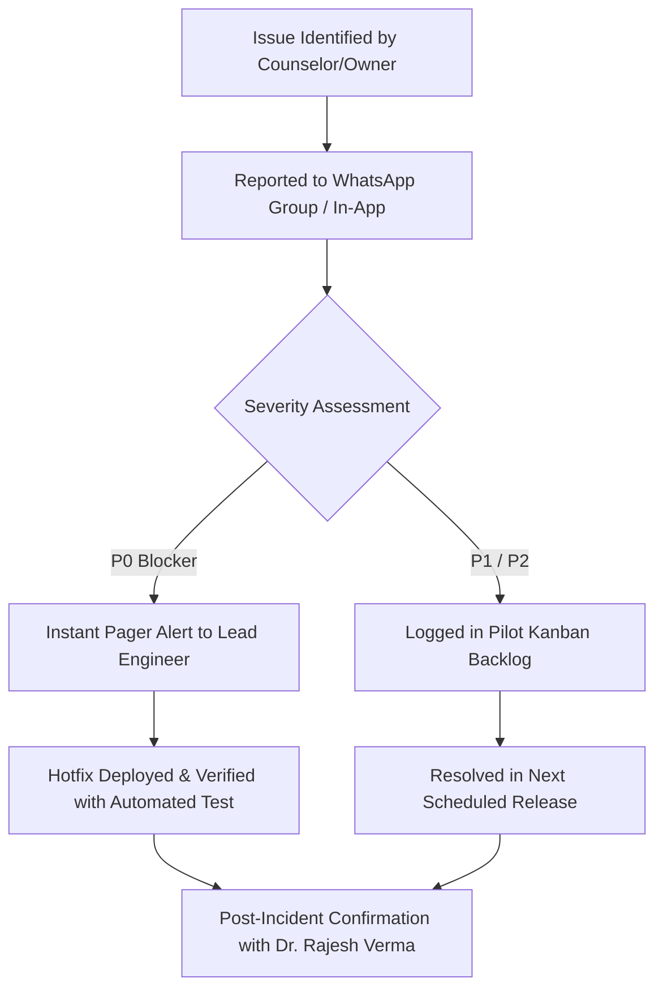

# AdmitFlow AI — Pilot Feedback & Issue Escalation Workflow
**Target**: Prerna Career Institute Pilot Stakeholders  
**SLA Targets**: P0 Blockers < 1 hour; P1 High < 4 hours; P2 Feature Requests < 24 hours.  

---

## 1. Issue Severity Classification
| Severity Level | Definition | Example Scenarios | Action / Response SLA |
|---|---|---|---|
| **P0 (Critical Blocker)** | System down, leads not capturing, or wrong fee stated by AI | Widget not responding; incorrect fee quoted to parent | Engineering hotfix within 60 mins; phone escalation |
| **P1 (High)** | Core workflow impaired, workaround exists | Slot booking conflict error false positive; report export failing | Assigned within 2 hours; patched within 6 hours |
| **P2 (Normal / Feedback)** | UI enhancement, new question chunk needed in knowledge base | Updating hostel menu details in RAG; adding counselor filter | Handled during daily sync / within 24 hours |

---

## 2. Feedback Logging Channels
1. **WhatsApp Pilot Group**: `[AdmitFlow x Prerna Pilot Ops]` (Direct hotline for Director Dr. Rajesh Verma & Counselors).
2. **In-App Issue Report**: Click "Report Issue" in the sidebar footer with automatic screenshot & error trace capture.
3. **Emergency Hotline**: Customer Success Architect direct line (`+91-98XXXXXXXX`).

---

## 3. Incident Lifecycle Workflow

---

## 4. Weekly Stakeholder Sync
- **When**: Every Saturday at 05:00 PM (30 minutes).
- **Attendees**: Institute Director (Dr. Rajesh Verma), Kota Center Head, AdmitFlow Lead Engineer, Customer Success Architect.
- **Agenda**:
  1. Review conversion metrics from the weekly report.
  2. Discuss any unresolved counselor feedback.
  3. Knowledge Base update requests (new batch dates or scholarship rounds).
